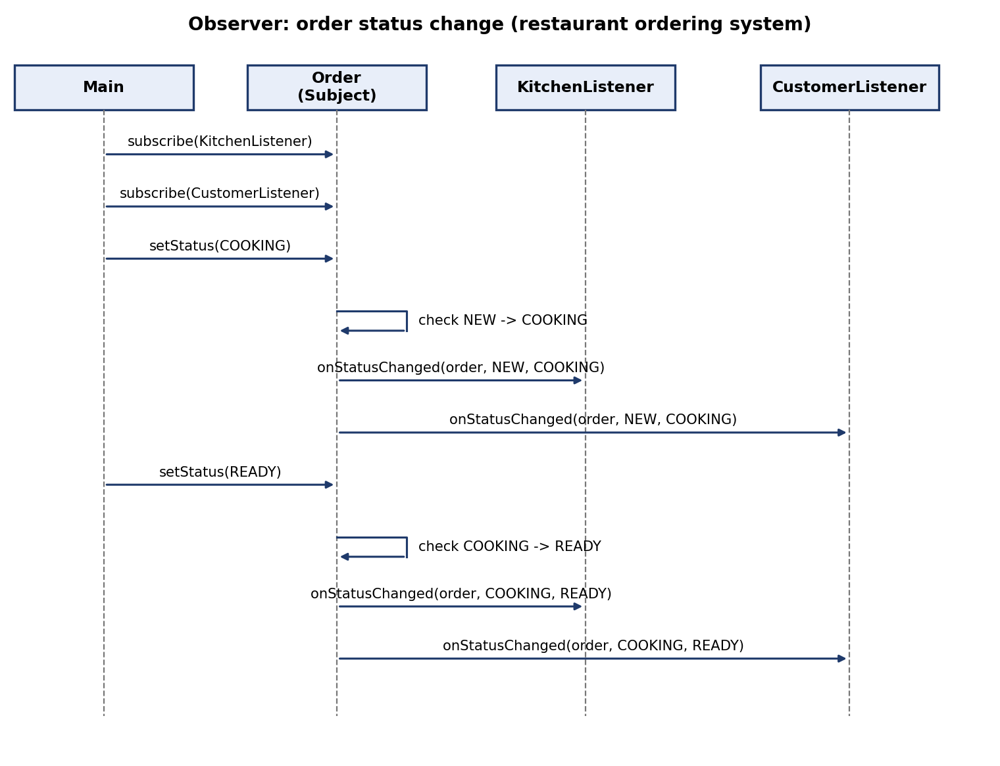

# Restaurant Ordering System: Builder and Observer

Author's part: **Builder + Observer** (package `restaurant`).

## 1. Builder

### Problem
An order in a restaurant consists of several parts: a list of dishes, a table number and an optional comment ("no onion"). A constructor with all these parameters is hard to read (`new Order(List.of(...), 5, "")`), easy to mix up, and does not prevent creating an invalid order (no dishes, no table).

### Solution
`OrderBuilder` collects the data step by step with a fluent interface and creates the `Order` only in `build()`:

```java
Order order = new OrderBuilder()
        .addDish("Pasta")
        .addDish("Tea")
        .table(5)
        .comment("no onion")
        .build();
```

`build()` validates the data: at least one dish and a positive table number are required, otherwise `IllegalStateException` is thrown. The `Order` constructor is package-private, so an order cannot be created bypassing the builder. The list of dishes is copied and made unmodifiable, so a finished order is not changed from outside.

### Participants
| Role | Class |
|------|-------|
| Builder | `OrderBuilder` |
| Product | `Order` |
| Client | `Main` / waiter code |

### Pros and cons
- (+) Readable creation of an object with many optional parts.
- (+) Validation in one place; an invalid `Order` never exists.
- (+) `Order` stays simple and its dishes list is immutable.
- (-) One extra class that duplicates the fields of `Order`.

## 2. Observer

### Problem
When the status of an order changes (NEW → COOKING → READY), several parties must find out: the kitchen display and the customer. `Order` must not depend on these concrete classes, otherwise adding a new receiver (for example, a waiter) would require changing `Order`.

### Solution
`Order` is the **Subject**. It keeps a list of `OrderListener` objects and offers `subscribe` / `unsubscribe`. When `setStatus` is called, the order checks that the transition is allowed (only forward, one step at a time), changes its status and calls `onStatusChanged(order, oldStatus, newStatus)` on every subscriber.

```java
order.subscribe(new KitchenListener());
order.subscribe(new CustomerListener());
order.setStatus(OrderStatus.COOKING);   // both listeners are notified
order.setStatus(OrderStatus.READY);     // both listeners are notified again
```

### Participants
| Role | Class |
|------|-------|
| Subject | `Order` |
| Observer (interface) | `OrderListener` |
| Concrete observers | `KitchenListener`, `CustomerListener` |
| State | `OrderStatus` (NEW, COOKING, READY) |

### Design decisions
- **Push model.** The listener receives the order and both statuses in the call, so it does not have to query the subject.
- **Iteration over a copy.** `notifyListeners` goes through a copy of the list, so a listener can unsubscribe during notification without `ConcurrentModificationException`.
- **Forward-only statuses.** An order cannot skip COOKING or go back; this keeps the listeners' view of the order consistent.

### Sequence diagram
See `observer_sequence.png` (source: `observer_sequence.mmd`).



### Verification
`OrderObserverTest` (JUnit 5) checks that:
1. the builder fills all fields and rejects an order without dishes or table;
2. **both listeners receive every status change** (`NEW->COOKING`, `COOKING->READY`);
3. an unsubscribed listener receives nothing;
4. skipping or reversing a status throws an exception.

Console demo output (`Main`):
```
Order#1 [table 5, dishes [Pasta, Tea], comment "no onion"]
[Kitchen] Order#1: NEW -> COOKING, dishes [Pasta, Tea]
[Customer, table 5] Your order is now COOKING
[Kitchen] Order#1 is ready, remove from the board
[Customer, table 5] Your order is now READY
```

### Pros and cons of Observer
- (+) Loose coupling: `Order` knows only the `OrderListener` interface.
- (+) New receivers (WaiterListener, BarListener) are added without changing `Order` (Open/Closed).
- (-) The order of notifications is not guaranteed by the pattern.
- (-) An exception in one listener interrupts notification of the rest (in this version it is not handled).

## 3. Possible questions at the defense
- **Why is the `Order` constructor package-private?** So that orders can only be created via `OrderBuilder` and always pass validation.
- **Why a copy of the listeners list in `notifyListeners`?** A listener may unsubscribe while being notified; iterating the original list would fail.
- **Push or pull?** Push: the listener gets the order and the old/new status as arguments.
- **How is Observer different from a plain method call?** The subject does not know the receivers; they can be added and removed at runtime.
- **Why does Builder return `this` from each method?** It allows a fluent chain; each step only stores data, creation happens in `build()`.
- **What would you change to add a waiter notification?** Write `WaiterListener implements OrderListener` and subscribe it; `Order` is not touched.
